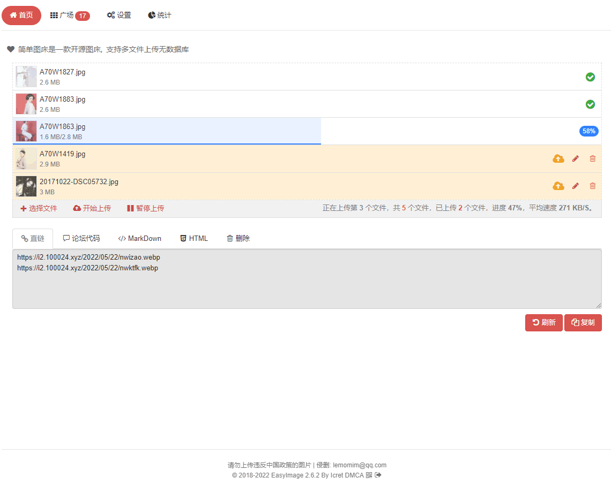
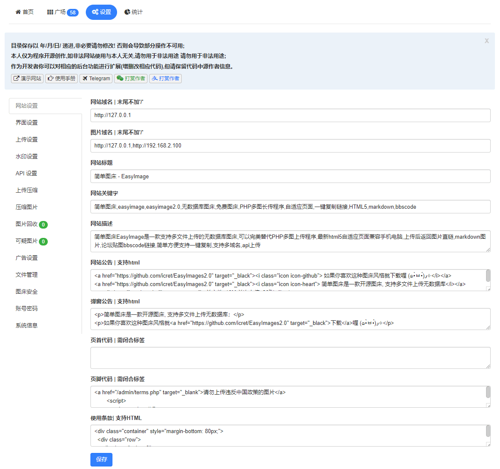
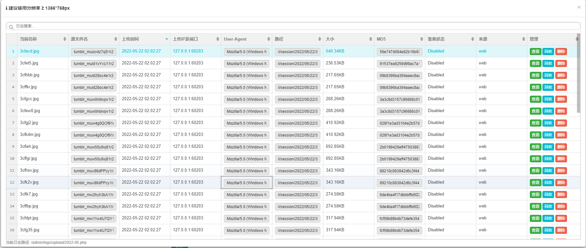

## fan-imagehost 简单图床

[](https://github.com/meimolihan/fan-imagehost/stargazers)
[](https://github.com/meimolihan/fan-imagehost/network/members)
[](http://php.net)
[](https://github.com/meimolihan/fan-imagehost/releases)
[](https://cdn.jsdelivr.net/gh/meimolihan/fan-imagehost@master/)
[](https://hub.docker.com/repository/docker/mobufan/fan-imagehost)
[](https://github.com/meimolihan/fan-imagehost/actions/workflows/release.yml)
[](https://github.com/meimolihan/fan-imagehost/blob/master/LICENSE)
[](https://jq.qq.com/?_wv=1027&k=jfXRHU8Y)

[演示](https://png.cm/) · [手册](https://meimolihan.github.io/fan-imagehost/#/) · [社区](https://github.com/meimolihan/fan-imagehost/discussions) · [Telegram](https://t.me/Easy_Image) - 插件: [Chrome](/docs/Chrome插件.md) · [Edge](/docs/Edge插件.md) · [PicGo](/docs/使用PicGo上传.md) · [ShareX](/docs/使用ShareX上传.md) · [Docker](/docs/三方安装指南.md)

目录: [安装](/docs/安装图床.md) | [部署](#项目部署) | [安全](/docs/安全配置.md) | [API](/docs/API.md) | [鉴黄](/docs/鉴黄.md) | [升级](/docs/图床更新升级.md) | [常见问题](/docs/常见问题.md) | [环境/兼容](#环境要求) | [更新日志](/docs/update.md) | [打赏开发者](/docs/打赏开发者.md) | [鸣谢](#鸣谢) | [许可证](#开源许可) 

> 始于2018年7月，支持多文件上传,简单无数据库,返回图片url,markdown,bbscode,html的一款图床程序
演示地址：[https://png.cm/](https://png.cm/) 
之前一直用的图床程序是:[PHP多图长传程序2.4.3](https://www.jb51.net/codes/40544.html)
由于版本过老并且使用falsh上传，在当前html5流行大势所趋下，遂利用基础知识新写了一个以html5为默认上传并且支持flash,向下兼容至IE9。
***本程序环境要求极低，适用于单一场景（游客上传）和个人使用，不适于多用户复杂场景***
>本人善写bug 发现bug可提交 [issues](https://github.com/meimolihan/fan-imagehost/issues) 追求稳定请下载 [稳定版](https://github.com/meimolihan/fan-imagehost/releases)

## 特点

* [x] 支持API
* [x] 支持仅登录后上传
* [x] 支持设置图片质量
* [x] 支持压缩图片大小
* [x] 支持文字/图片水印
* [x] 支持设置图片指定宽/高
* [x] 支持上传图片转换为指定格式
* [x] 支持限制最低宽度/高度上传
* [x] 支持上传其他文件格式
* [x] 在线管理图片
* [x] 支持网站统计
* [x] 支持设置广告
* [x] 支持图片鉴黄
* [x] 支持自定义代码
* [x] 支持上传IP黑白名单
* [x] 支持上传日志IP定位
* [x] 支持限制日上传次数
* [x] 支持创建仅上传用户
* [x] 对于安装环境要求极低
* [x] 对于服务器性能要求极低
* [x] 理论上[支持所有常见格式](/docs/其他格式.md)
* [x] 更多功能支持请安装尝试···

 ## 界面演示
 
 
 
 
 
 
 

## 环境要求
> 推荐环境：Nginx + PHP≥7.0 + linux

- ##### 兼容

 >最低`PHP 5.6`,推荐`PHP≥7.0`及以上版本，需要PHP支持`Fileinfo,iconv,zip,mbstring,openssl`扩展,如果缺失会导致无法上传/删除图片
 文件上传视图提供文件列表管理和文件批量上传功能，允许拖拽（需要`HTML5`支持）来添加上传文件，支持上传大图片，优先使用`HTML5`旧得浏览器自动使用`Flash和Silverlight`的方式兼容

## 项目部署

- 默认 web 端口：**8083**
- 首次安装默认管理员账号：**admin / admin@123**，登录后请及时修改
- 配置与上传图片默认保存在数据目录，便于备份与迁移

### docker-compose 部署（推荐）

部署本项目的 [docker-compose.yml](https://github.com/meimolihan/fan-imagehost/blob/main/docker-compose.yml)，默认拉取 Docker Hub 镜像 `mobufan/fan-imagehost`。

```shell
# 1. 创建 fan-imagehost 目录
mkdir -p /root/fan-imagehost && cd /root/fan-imagehost

# 2. 下载 docker-compose.yml 文件
wget https://raw.githubusercontent.com/meimolihan/fan-imagehost/main/docker-compose.yml

# 3. 启动服务
docker compose up -d
```

启动后访问 `http://服务器IP:8083/`，按安装向导完成初始化；数据持久化在宿主机 `./fan-imagehost` 目录。

### docker 镜像

```shell
# 数据目录挂载到宿主机 /root/fan-imagehost
docker run -d \
  --name fan-imagehost \
  -p 8083:80 \
  --restart=always \
  -v /root/fan-imagehost:/var/lib/fan-imagehost \
  -e TZ=Asia/Shanghai \
  mobufan/fan-imagehost:latest
```

### 一键脚本安装（systemd）

适用于直接部署在 Linux 服务器（非 Docker），脚本会自动安装 PHP 运行环境与扩展、注册 systemd 服务（以 `php -S` 运行），并安装内置命令 `fan-imagehost`。

```shell
# 默认端口 8083，数据目录 /var/lib/fan-imagehost/data
bash scripts/install.sh

# 自定义端口与数据目录，免交互
bash scripts/install.sh -p 8083 -d /var/lib/fan-imagehost/data -y
```

### 内置 CLI 管理命令

安装后可直接使用 `fan-imagehost` 命令管理服务：

| 命令 | 说明 |
|------|------|
| `fan-imagehost status` | 查看运行方式（systemd / 直接运行）、PID、监听端口、访问地址、运行时长、内存与路径 |
| `fan-imagehost credentials` | 查看登录用户名与初始密码提示 |
| `fan-imagehost start` / `stop` / `restart` | 启动 / 停止 / 重启 systemd 服务 |
| `fan-imagehost uninstall [-y] [--purge\|--keep-data]` | 停止并移除服务/进程，删除程序与安装记录，可选删除数据目录 |
| `fan-imagehost version` | 查看版本号 |

```shell
# 查看服务状态（含版本号与访问地址）
fan-imagehost status

# 查看登录用户名与初始密码提示
sudo fan-imagehost credentials

# 免确认卸载，保留数据目录
sudo fan-imagehost uninstall -y

# 免确认卸载，并删除数据目录
sudo fan-imagehost uninstall -y --purge
```

### 备份与还原

systemd 安装方式自带备份/还原脚本，脚本会自动读取 `/etc/fan-imagehost.conf` 中的 `APP_DIR` / `DATA_DIR` / `BACKUP_DIR`，默认备份目录为 `${APP_DIR}/backup`。本仓库同名脚本位于 `scripts/` 目录，安装后在程序目录 `scripts/` 下亦有副本。

```shell
# 备份（在线打包、不停服，默认保留最近 6 份）
bash scripts/fan-imagehost_backup.sh

# 指定备份目录与保留份数（两种传参顺序均可）
bash scripts/fan-imagehost_backup.sh /data/bak 8
bash scripts/fan-imagehost_backup.sh 8 /data/bak
```

```shell
# 还原（默认取备份目录中最新一份；还原过程中服务会短暂停止并自动重启）
bash scripts/fan-imagehost_recover.sh

# 指定备份目录与还原文件（文件名需形如 FanImageHost-*.tar.gz）
bash scripts/fan-imagehost_recover.sh /data/bak FanImageHost-2026-10-17_21-31-22.tar.gz
```

说明：

- 备份产物为 `FanImageHost-YYYY-MM-DD_HH-MM-SS.tar.gz`，只包含数据目录（`DATA_DIR`）内容（即 `config` 配置与上传图片）。
- 还原前请确认备份文件仍在对应 `BACKUP_DIR` 内，且数据目录路径与当前服务一致。
- 上述命令需要在运行本图床的服务器上以 root 权限执行。

### 环境变量

一键脚本安装支持以下环境变量：

| 变量名称 | 说明 | 默认值 |
|---------|------|--------|
| `FAN_IMAGEHOST_ADMIN_USER` | 初始管理员用户名 | `admin` |
| `FAN_IMAGEHOST_ADMIN_PASSWORD` | 初始管理员密码 | `admin@123` |
| `FAN_IMAGEHOST_DOMAIN` | 站点访问地址（写入配置） | `http://<IP>:<PORT>` |
| `FAN_IMAGEHOST_VERSION` | 发布包版本（`latest` 或如 `v0.0.1`） | `latest` |
| `FAN_IMAGEHOST_REPO` | 源码仓库/镜像地址（国内网络加速用） | GitHub 官方仓库 |

## 鸣谢
 
- [verot](https://github.com/verot/class.upload.php "verot" )
- [ZUI](https://github.com/easysoft/zui/tree/zui1 "ZUI" )
  
## 开源许可

 - [GPL-2.0](https://github.com/meimolihan/fan-imagehost/blob/master/LICENSE) 
 - Copyright © 2018 EasyImage Developer By [Icret](https://github.com/icret)
 
* have fun!

[](https://github.com/meimolihan/fan-imagehost/stargazers)